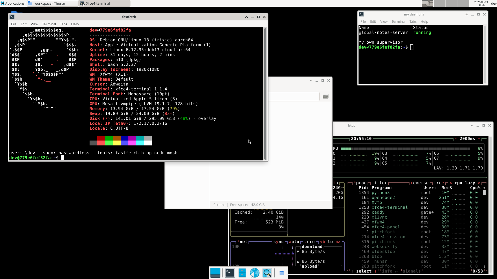

# agent-env

[](https://github.com/dtinth/agent-env/actions/workflows/docker.yml)

A Docker image that turns an agent workstation into a hosted, sign-in-protected
service: a desktop, a terminal, a file manager, SSH, a browser. Run
[OpenCode](https://opencode.ai) as its agent with `AGENT_ENV_PRESET=opencode`, or
bring your own.



Behind one sign-in (Google, GitHub or basic auth) you get:

- **`/`**: your app, or OpenCode's web UI under the `opencode` preset
- **`/~env/terminal`**, **`/~env/desktop`**, **`/~env/files`**: a shell, an XFCE desktop and a file manager in the browser
- **`/pitchfork`**: a dashboard for your own daemons
- **SSH and mosh**, plus agent-browser with a headed Chromium you can watch on the desktop

## Quick start

Set it up in the browser at [dtinth.github.io/agent-env](https://dtinth.github.io/agent-env/),
or in a terminal (Node 22.18+, nothing else to install):

```bash
git clone https://github.com/dtinth/agent-env && cd agent-env
node setup.ts --out ~/agent-env-deploy
```

Either way you get a `compose.yaml` and `.env` for the image on GHCR
(`ghcr.io/dtinth/agent-env`, amd64 and arm64). Run it again later to upgrade;
your answers and secrets are kept.

Or try it locally with basic auth:

```bash
docker run -d --name agent-env --shm-size=2g \
  -p 8080:8080 -p 2222:22 \
  -e AUTH_MODE=basic -e GATEWAY_PASSWORD=changeme \
  -e PUBLIC_URL=http://localhost:8080 \
  -e AGENT_ENV_PRESET=opencode \
  -v agent-env-workspace:/workspace -v agent-env-home:/home/dev \
  ghcr.io/dtinth/agent-env
```

Open <http://localhost:8080> and sign in as `dev` / `changeme`;
<http://localhost:8080/~env/> lists everything the environment serves.

## Things to know

- **Everything behind the gate is root-capable** (`dev` has passwordless sudo). Use a
  sign-in allow list, and give each person their own container.
- **Mount `/workspace`, `/home/dev` and `/var/lib/agent-env`.** Without them,
  recreating the container loses your code, the agent's setup and the SSH host keys.
- **Everything is configured with environment variables**; [`.env.example`](.env.example)
  lists them all, annotated. Any variable also accepts a `<NAME>_FILE` form for secrets.
- **Only ports 8080 (web) and 22 (SSH) listen externally.** Terminate TLS in front of 8080.

## Everything else

How authentication, presets, supervision, volumes, toolchains, rootless Docker, the
desktop and the rest work is in [AGENTS.md](AGENTS.md), which is written for people
and agents changing this repository but is the full reference.
